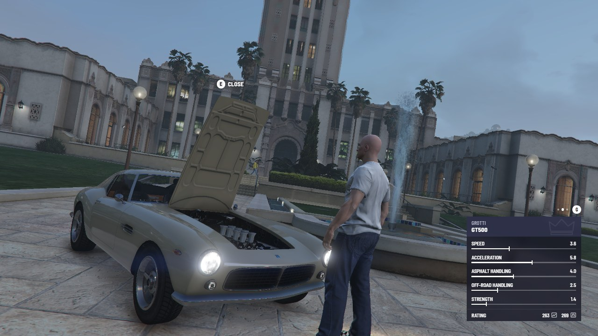
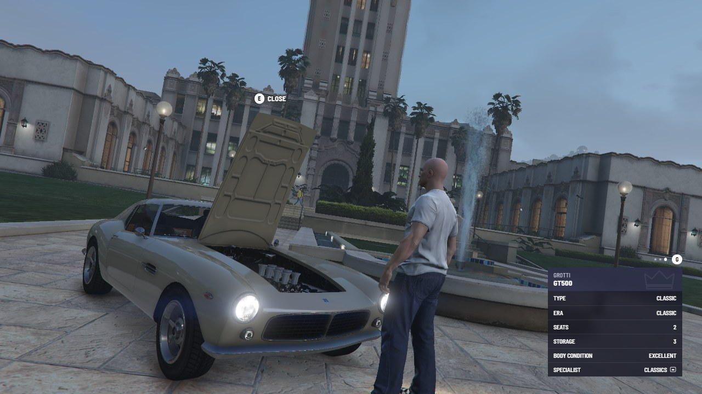
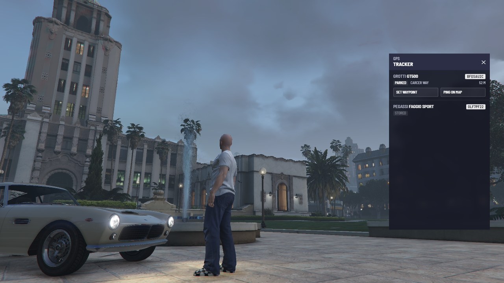
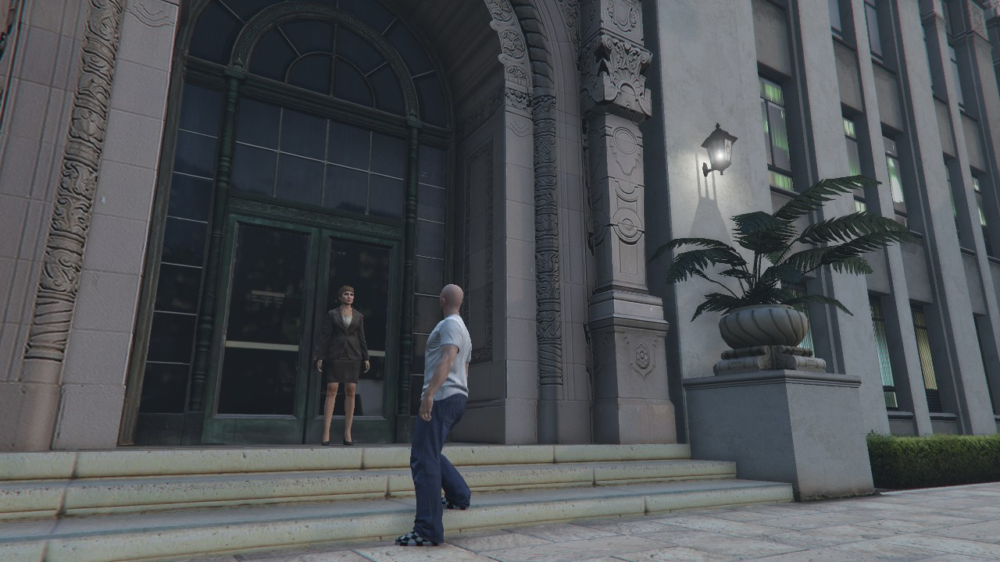
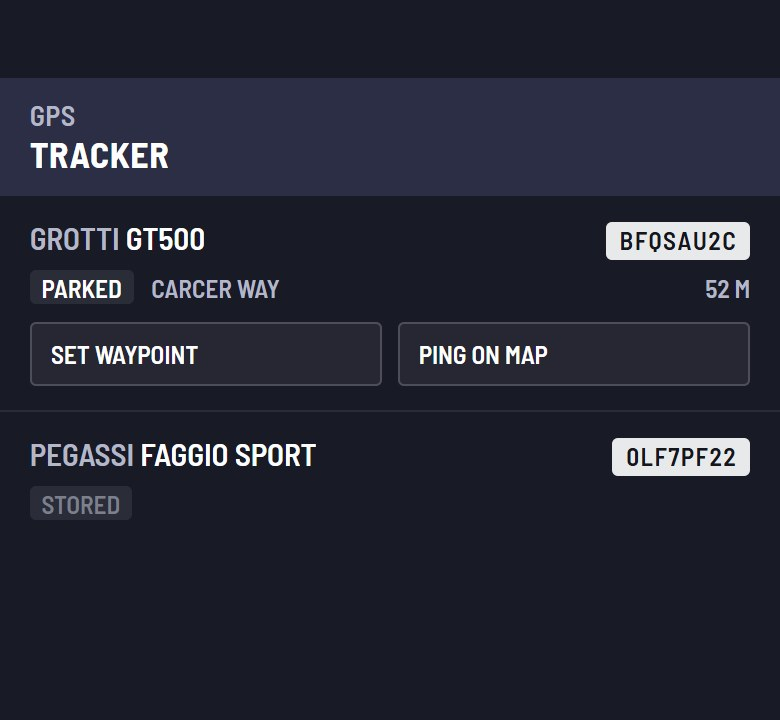

# bakery_vehicleinspect

GTA 6 style vehicle inspection for FiveM. Pop the hood of a car to see its stats, then register it, fit a security system or a GPS tracker at the registration clerk.

Works with **QBX**, **QBCore** and **ESX**.


## Screenshots

| Stats | Details |
|---|---|
|  |  |

| GPS tracker (`/tracker`) | Registration clerk |
|---|---|
|  |  |



*The tracker as a phone app (LB Phone, GKS Phone, CodeM mPhone, NPWD).*

## Features

- **Inspect** – walk up to the front of a car and press **E**. The hood opens, the camera moves in and a panel shows three pages (switch with **G**):
  - access, security, tracker, sell value and registration
  - speed, acceleration, handling, strength and rating
  - type, era, seats, storage, condition and specialist
- **Registration clerk** – an NPC you target (ox_target / qb-target) to open an ox_lib menu. It lists only the vehicles you own and sells:
  - **Registration**: a share of the car's price
  - **Security system**: an alarm
  - **GPS tracker**
- **Security system** – if someone who isn't the owner (and has no keys) pulls a locked door, gets behind the wheel or opens the hood, the alarm sounds. The owner gets a notification and a flashing blip on the map.
- **GPS tracker** – see where your tracked cars are, set a waypoint or ping them on the map. Open it with `/tracker` or as an app on **LB Phone**, **GKS Phone**, **CodeM mPhone** or **NPWD**.

## Requirements

- [ox_lib](https://github.com/overextended/ox_lib)
- [oxmysql](https://github.com/overextended/oxmysql)
- ox_target or qb-target (for the clerk)
- QBX, QBCore or ESX (prices, money and vehicle ownership)

## Installation

1. Put `bakery_vehicleinspect` in your resources folder.
2. Add `ensure bakery_vehicleinspect` to your `server.cfg`, after your framework, ox_lib and oxmysql. If you use NPWD, put it **before** `ensure npwd`.
3. Start the server. The database table `bakery_vehicle_security` is created automatically.

The UI is already built (`web/dist`), so you don't need Node.js unless you change it.

## Configuration

Everything is in [`config.lua`](config.lua):

| Setting | What it does |
|---|---|
| `Config.Framework` | `'auto'`, `'qbx'`, `'qb'`, `'esx'` or `'none'` |
| `Config.Keys` | Default keys for opening the hood (`E`) and switching pages (`G`). Players can rebind them in FiveM's key bindings. |
| `Config.Office.locations` | Where the registration clerk stands, as `vector4(x, y, z, heading)`. Add more lines for more clerks. |
| `Config.Office.prices` | Price of the security system and the GPS tracker |
| `Config.RegisterMultiplier` / `Config.SellMultiplier` | Registration cost and sell value as a share of the car's price |
| `Config.Alarm` | How long the alarm sounds, the cooldown and how long the owner's blip lasts |
| `Config.Tracker` | `/tracker` command, which phone to use, and the app name |
| `Config.Classes`, `Config.Categories`, `Config.Eras`, `Config.Models` | The panel's type, specialist, storage and era per class, framework category or model |

## Integrations (the `bridge/` folder)

Anything that depends on another resource lives in `bridge/`, so you can swap it without touching the rest.

| File | Change it to… |
|---|---|
| `bridge/server/framework.lua` | support another framework (player id, bank money, owned vehicles, vehicle prices) |
| `bridge/client/keys.lua` | add your vehicle keys script. Players with keys never set off the alarm. |
| `bridge/client/phone.lua` | add another phone. Each phone is one entry that registers the same app page. |
| `bridge/client/target.lua` | use another target script |
| `bridge/client/notify.lua` | use your own notifications |

### NPWD

Add the resource to the `apps` list in `npwd/config.json`:

```json
"apps": ["npwd_qbx_mail", "npwd_qbx_garages", "bakery_vehicleinspect"]
```

## Exports

For lockpick, hotwire, keys or MDT scripts.

**Client**

```lua
-- Set off the security system (does nothing if the car has none, or the player owns it / has keys)
exports.bakery_vehicleinspect:TriggerAlarm(vehicle)
```

**Server**

```lua
-- { owner, registered, alarm, tracker } or nil
local security = exports.bakery_vehicleinspect:GetVehicleSecurity(plate)

-- field: 'registered' | 'alarm' | 'tracker', owner: citizenid (QBX/QBCore) or identifier (ESX)
exports.bakery_vehicleinspect:SetVehicleSecurity(plate, owner, 'alarm', true)
```

## Editing the UI

```bash
cd web
npm install
npm run dev     # preview in a browser: E toggles the panel, G switches pages, ?view=tracker shows the tracker
npm run build   # writes web/dist, which the game loads
```

## License

[GPL-3.0](LICENSE)
